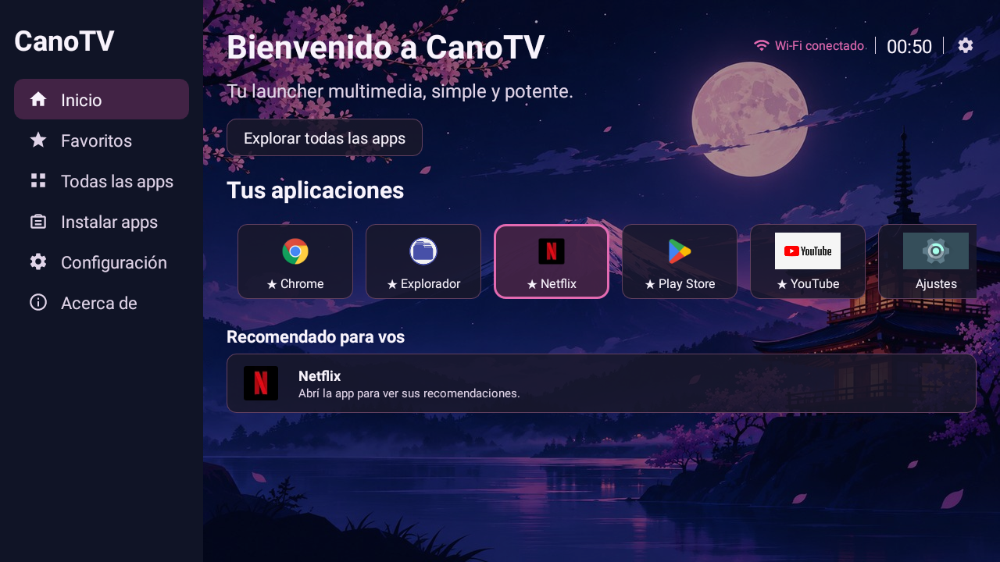
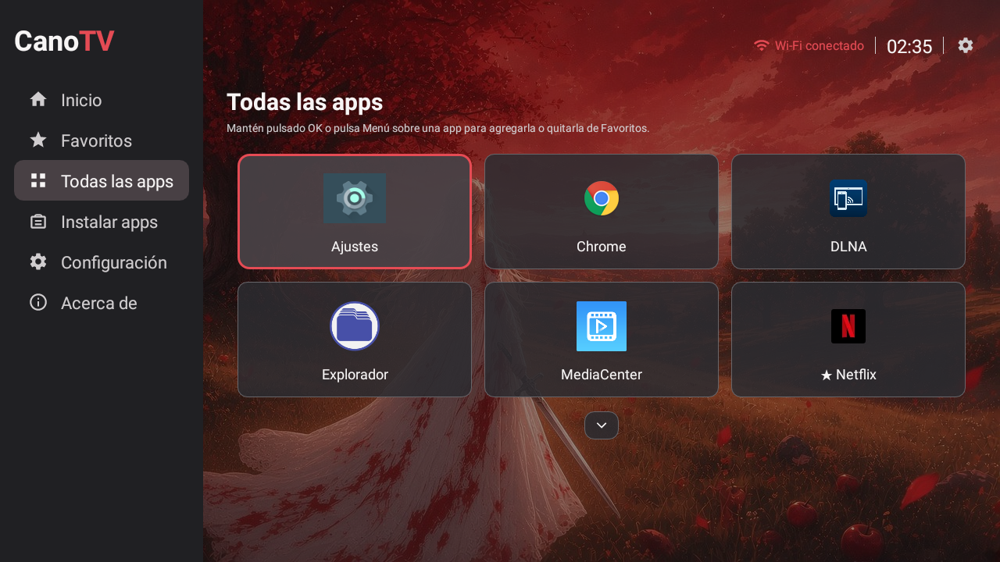
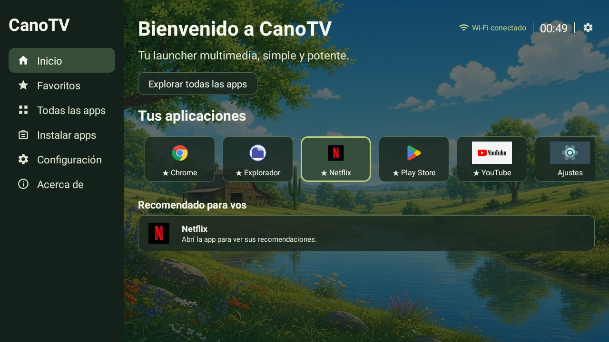
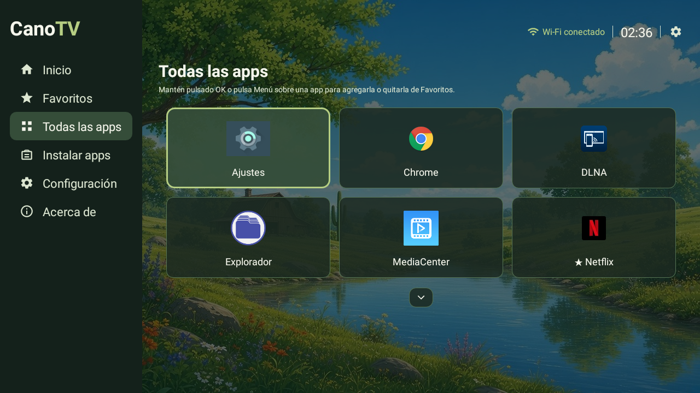
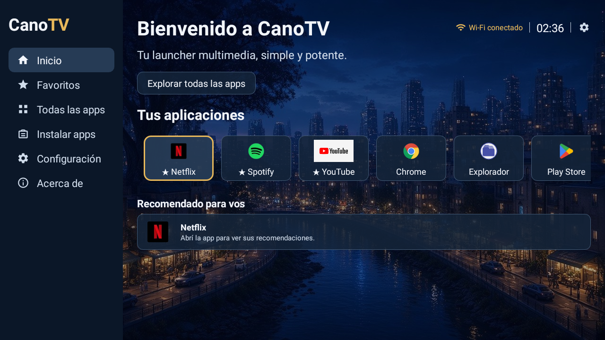
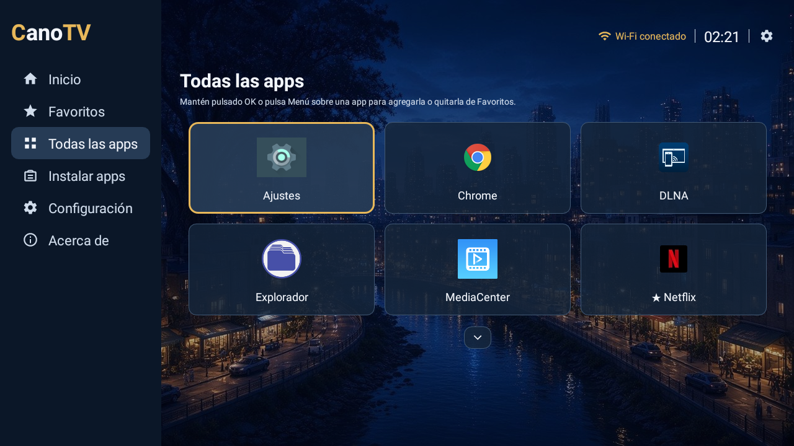
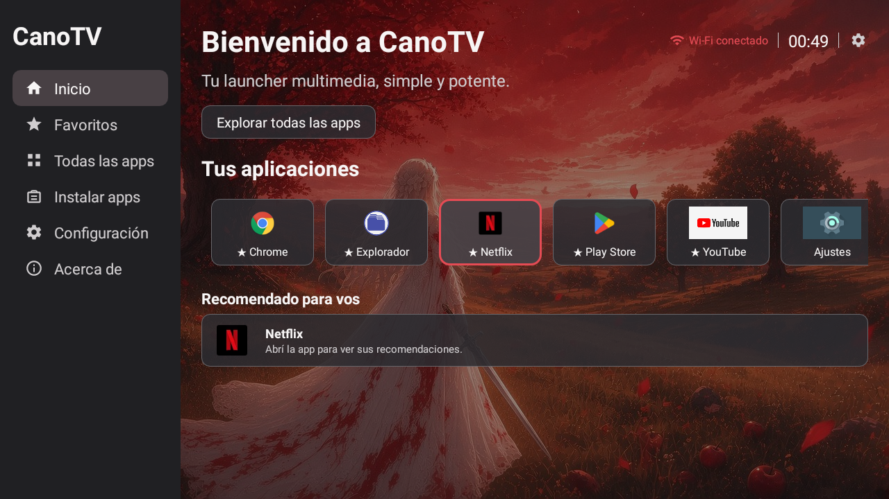
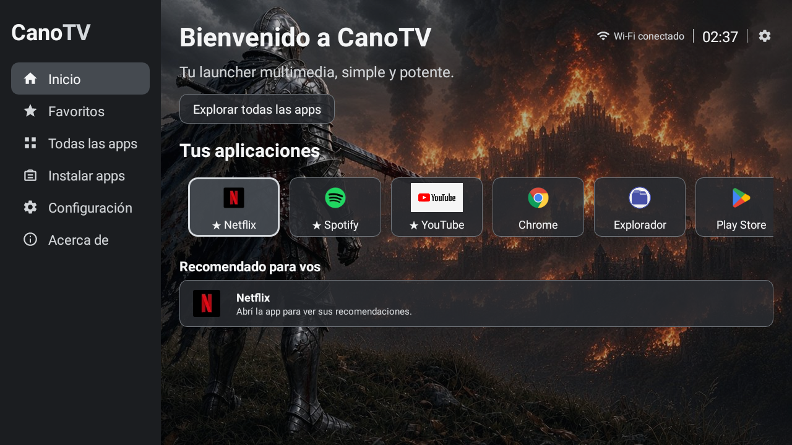
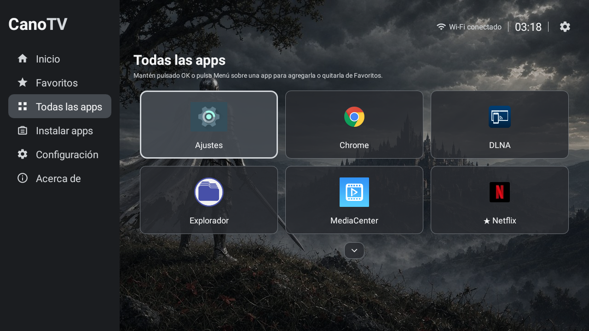

# CanoTV

Launcher Android ligero, pensado para TV Box y navegación con control remoto. Organiza las aplicaciones instaladas en Inicio, Favoritos y Todas las apps; incluye temas, idioma Español/Inglés y controles D-pad.

> **Estado:** versión personal 1.0.0. Validada principalmente en un MXQ Pro con Android API 25 y pantalla 1280 × 720. No se garantiza compatibilidad con todos los TV Box ni con todas las aplicaciones de streaming.

## Capturas

| Tema | Inicio | Todas las apps |
|---|---|---|
| Púrpura |  |  |
| Salvia |  |  |
| Azul noche |  |  |
| Rojo |  |  |
| Oscuro |  |  |

También hay capturas de [Favoritos](screenshots/favorites-purple.png), [Ajustes](screenshots/settings-purple.png) y [la tienda del dispositivo](screenshots/install-apps-play-store.png).

## Funciones

- Detecta actividades instaladas para Android TV y lanzadores Android.
- Muestra tarjetas de apps, favoritos y una cuadrícula con desplazamiento.
- Permite abrir apps con OK y navegar con D-pad.
- Ofrece cinco temas, preferencias de idioma, familia tipográfica y tamaño de etiquetas.
- Mantiene accesible el launcher original del dispositivo; CanoTV no reemplaza ni modifica Android.

## Instalar en un TV Box

### Descargar una versión

Consulta la sección **Releases** de GitHub y descarga `app-release.apk`. Si todavía no hay una versión publicada, compílala desde el código siguiendo la sección siguiente.

1. Copia el APK al TV Box por USB o transfiérelo con ADB.
2. Autoriza la instalación desde esa fuente cuando Android lo solicite.
3. Abre CanoTV y, si quieres usarlo como inicio, selecciónalo en el diálogo de launcher o en los ajustes de aplicaciones predeterminadas.
4. Conserva el launcher original como alternativa de recuperación.

Para actualizar una instalación, instala el APK firmado con la misma clave que la versión anterior. Android rechazará una actualización firmada con otra clave.

Si instalas el APK publicado y luego compilas el código con tu propia clave, Android no podrá actualizar esa instalación con tu APK. Para cambiar de firma, desinstala primero la app (se borrarán sus preferencias locales) y luego instala la compilación propia.

### Instalar con ADB

Con depuración USB o ADB ya habilitado y autorizado en el dispositivo:

```bash
adb install -r app-release.apk
```

ADB inalámbrico es opcional; usa la dirección que muestre tu propio TV Box y no compartas esos datos en issues o capturas públicas.

## Compilar desde el código

### Requisitos

- JDK 17.
- Android SDK con la plataforma 34 y Build Tools compatibles.
- Android Studio es opcional; el Gradle Wrapper incluido permite compilar desde terminal.
- Conexión a Internet durante la primera compilación para obtener dependencias.

En Linux o macOS:

```bash
./gradlew testDebugUnitTest assembleDebug
```

En Windows:

```bat
gradlew.bat testDebugUnitTest assembleDebug
```

APK de prueba: `app/build/outputs/apk/debug/app-debug.apk`.

La configuración local del SDK se crea con Android Studio o en `local.properties`; este archivo está excluido de Git.

### Compilar APK release firmada

Android exige que las APK estén firmadas para instalarlas y para permitir actualizaciones consistentes. La clave no es una licencia comercial: es la identidad criptográfica de quien publica la app. Cada persona que genere su propia versión debe crear y conservar su propia clave.

1. Genera una clave privada fuera de este repositorio:

   ```bash
   keytool -genkeypair -v -keystore canotv-release.jks -alias canotv -keyalg RSA -keysize 3072 -validity 10000
   ```

2. Guarda el archivo `.jks` y sus contraseñas en un lugar privado con copia de seguridad. **Nunca los subas a GitHub ni los envíes por chat.**
3. Añade estas propiedades a `~/.gradle/gradle.properties` (en Windows, `%USERPROFILE%\.gradle\gradle.properties`), usando la ruta y contraseñas de tu clave:

   ```properties
   canotvReleaseStoreFile=/ruta/privada/canotv-release.jks
   canotvReleaseStorePassword=TU_CONTRASENA_DEL_KEYSTORE
   canotvReleaseKeyAlias=canotv
   canotvReleaseKeyPassword=TU_CONTRASENA_DE_LA_CLAVE
   ```

4. Compila:

   ```bash
   ./gradlew assembleRelease
   ```

APK: `app/build/outputs/apk/release/app-release.apk`. Si falta la configuración de firma, Gradle no firma la variante release; no distribuyas un APK sin firmar.

## Privacidad

- CanoTV no solicita permiso de Internet ni envía analítica o telemetría.
- Consulta localmente las apps lanzables para construir las listas.
- Guarda tema, idioma, tipografía, tamaño y favoritos en preferencias privadas de Android.
- Solo pide acceso al estado de red para mostrar si hay Wi‑Fi.
- Las preferencias no se incluyen en la copia de seguridad de Android.
- No subas a GitHub rutas locales, direcciones IP, nombres de red, números de serie, capturas de Ajustes del dispositivo ni claves privadas.

## Compatibilidad y limitaciones

- `minSdk 25` (Android 7.1); `compileSdk 34`.
- Se distribuye por APK/USB/ADB, no por Google Play; `targetSdk 25` se conserva para el TV Box de referencia.
- Validado en un TV Box con API 25, control D-pad y resolución 1280 × 720. En otros modelos pueden variar el foco, las apps instaladas, los permisos del sistema y la selección del launcher.
- El acceso a Netflix u otras plataformas solo abre la app instalada. Compatibilidad, certificación, reproducción y navegación interna dependen del dispositivo y de cada proveedor.
- El código no instala APK de terceros ni evita las protecciones de Android.

## Documentación

- [Arquitectura y descripción de archivos](docs/ARQUITECTURA.md)
- [Instalación y recuperación](docs/INSTALACION.md)
- [Entorno de compilación](docs/BUILD_ENVIRONMENT.md)
- [Pruebas y límites conocidos](docs/PRUEBAS.md)
- [Estado y roadmap](docs/ROADMAP.md)

## Licencia

Este repositorio aún no declara una licencia de reutilización. Puedes descargar el proyecto para estudiarlo y probarlo; reutilizar o redistribuir el código y los recursos requiere autorización explícita del titular.
